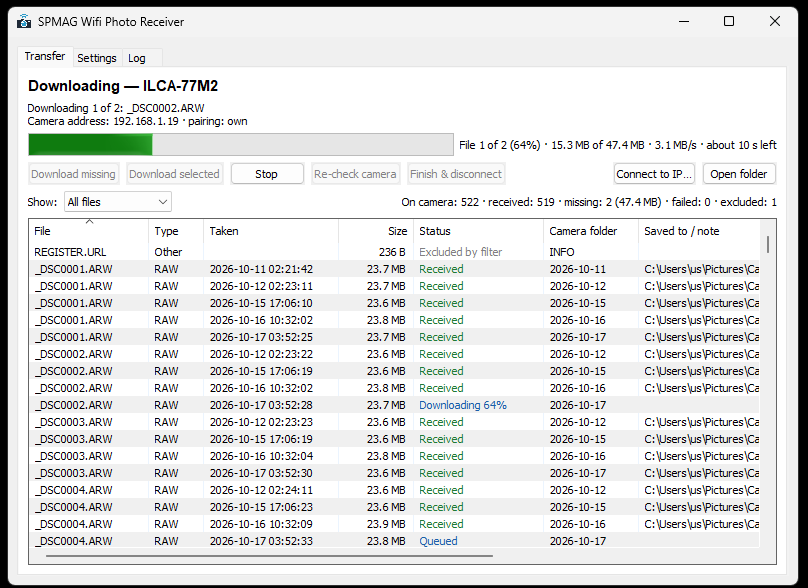
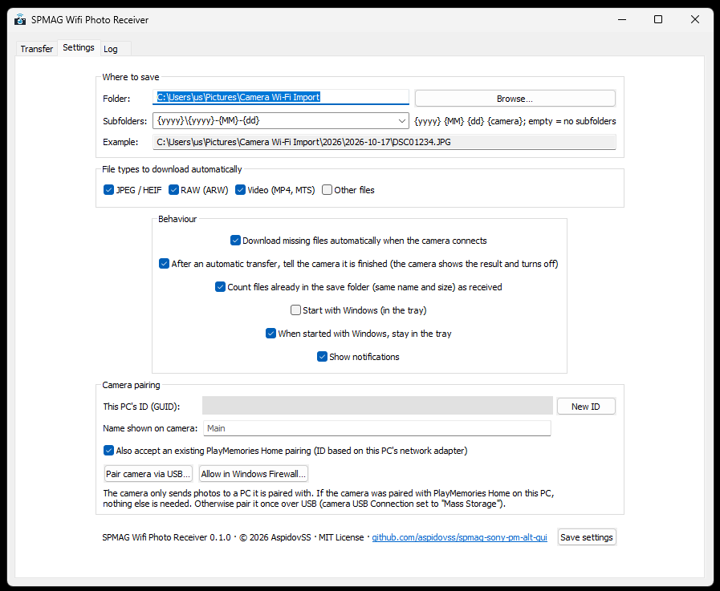
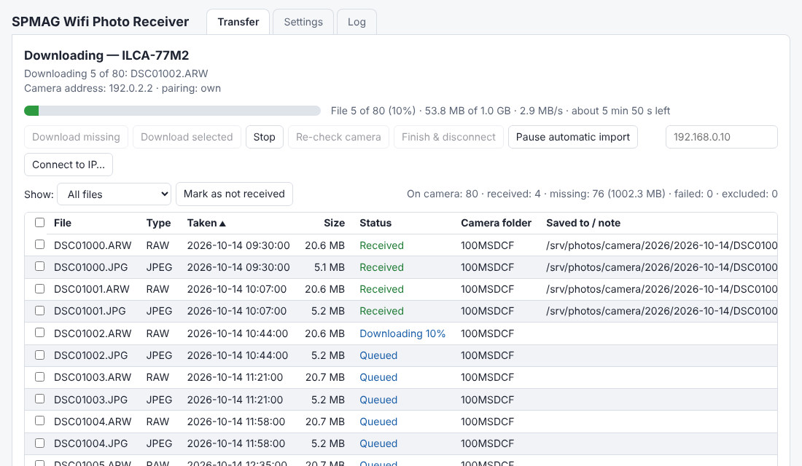
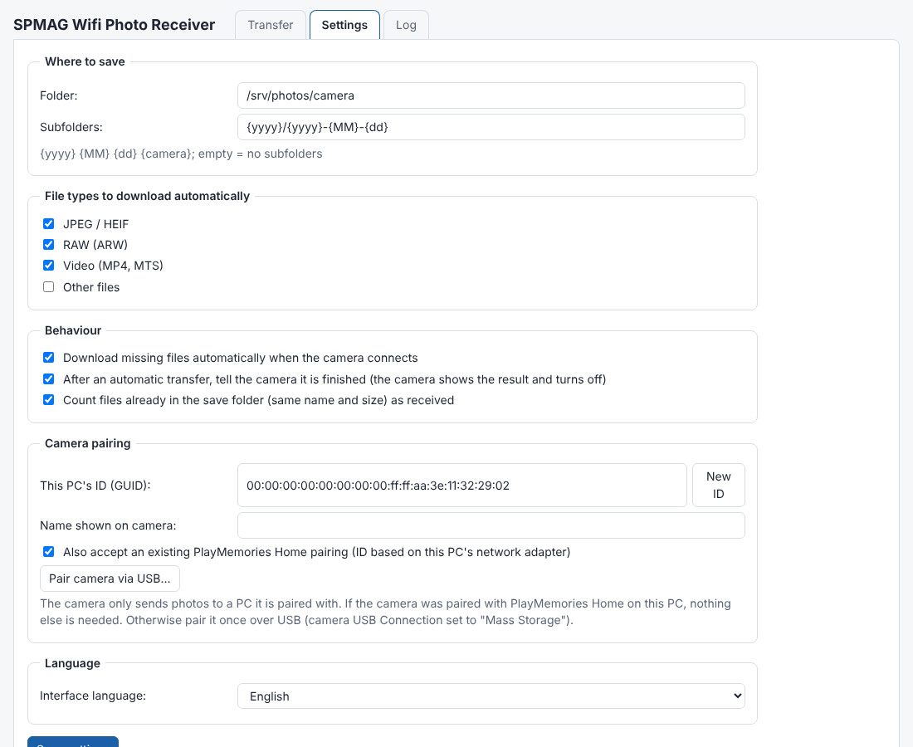

<p align="center"></p>

# SPMAG Wifi Photo Receiver

[](https://go.dev/)
[](https://github.com/aspidovss/spmag-sony-pm-alt-gui/releases/latest)
[](https://github.com/aspidovss/spmag-sony-pm-alt-gui/releases/latest)
[](SECURITY.md)
[](https://github.com/aspidovss/spmag-sony-pm-alt-gui/releases/latest)
[](LICENSE)
[](SECURITY.md)
[](SECURITY.md)

**Repository:** <https://github.com/aspidovss/spmag-sony-pm-alt-gui> · © 2026 AspidovSS · MIT License

A small open-source Windows program that receives photos from Sony cameras over
Wi-Fi (the camera's **Send to Computer** function). It replaces the Wi-Fi import
part of PlayMemories Home and nothing else: no catalogue, no editor, no
online services.

> **AI-generated project.** All source code, documentation and other text in
> this repository were generated by an AI model (Anthropic Claude) at the
> request and under the direction of the maintainer. The maintainer tested
> the program with a real camera. Review the code before relying on it.





## Features

* Detects the camera automatically when you start *Send to Computer* on it.
* Saves files to a folder you choose, in date subfolders (the pattern is configurable).
* **Reconciles** the camera with the PC. Every file on the card is shown as
  *Received*, *Missing*, *Failed* or *Excluded by filter*. You can download all
  missing files or pick files by hand.
* File type filter: JPEG/HEIF, RAW (ARW), video, other.
* Tells the camera when the transfer is finished. The camera shows the result
  and switches off, as with PlayMemories Home.
* Live transfer speed and estimated time left for the whole transfer.
* System tray icon, start with Windows, notifications.
* Built-in pairing over USB. It also accepts an existing PlayMemories Home pairing.
* A single portable `.exe` without installer or runtime (Windows 10/11, x64).
* **Allowed cameras list**: restrict the program to your own cameras (IP,
  network, serial number, model). Other devices on the network are ignored.
* **Browser interface** on Windows and Linux: switch it on in the settings and
  choose the port, login and password. Control the program from a phone or
  another computer.
* **Linux**: one-file **AppImage**, service `wpr watch` (systemd, `.deb` package
  or Docker) for desktops, home servers, NAS and Raspberry Pi (amd64 and arm64),
  with the browser interface and USB pairing.
* Command-line tool `wpr` for troubleshooting and scripting.

### Tested cameras

| Camera | Firmware | Wi-Fi transfer | PlayMemories pairing | USB pairing |
|---|---|---|---|---|
| Sony α77 II (ILCA-77M2) | 2.0 | ✅ | ✅ | ✅ |

Other Sony cameras with *Send to Computer* use the same protocol and may
work. See the [theoretical compatibility list](docs/COMPATIBILITY.md) (only the
row above is verified) and please report results, or add a capture of your
camera (see [testdata](testdata/README.md)).

## Languages

The interface (windows, menus, tray, dialogs, status texts) is available in
English, 简体中文, Español, Français, Deutsch, Português (Brasil), Русский,
日本語, 한국어 and Italiano. By default the Windows display language is used;
change it in **Settings → Language** (the program restarts to apply it). Log
files and the command-line tool stay in English. The translations were produced
with AI assistance and have not been reviewed by native speakers — corrections
are welcome as pull requests (`internal/i18n/<code>.go`; a test checks that
every language has every text).

## Quick start

1. Download `SPMAG-WifiPhotoReceiver-…-windows-amd64.zip` from
   [Releases](https://github.com/aspidovss/spmag-sony-pm-alt-gui/releases), unpack it and run `SPMAG-WifiPhotoReceiver.exe`.
   Allow it in the Windows Firewall prompt (private networks), or later use
   **Settings → Allow in Windows Firewall…**.
2. **Pair the camera once.** The camera only sends to PCs it knows.
   * If the camera was paired with PlayMemories Home on this PC, nothing is
     needed: the program accepts that pairing. Keep *"Also accept an existing
     PlayMemories Home pairing"* enabled.
   * Otherwise use **Settings → Pair camera via USB…**. On the camera set
     *MENU → Setup → USB Connection → Mass Storage*, connect it by USB and
     follow the dialog. Windows asks for administrator rights.
3. Connect the camera's Wi-Fi to the same network as the PC
   (*MENU → Wireless → Access Point Set.*).
4. On the camera choose *MENU → Wireless → Send to Computer*. The program
   finds the camera, reads its file list and downloads the missing files.

Turn off *"Download missing files automatically"* in Settings if you prefer to
look at the list first. Then use **Download missing** or **Download selected**.
Close PlayMemories Home if it is still installed, because it may grab the camera first.

## Browser interface (Windows and Linux)

Both versions can show their window in a browser. On Windows open **Settings →
Web interface**; on Linux the same group is on the *Settings* tab of the page
(or start with `wpr watch -ui`, see AppImage below).

| Option | Meaning |
|---|---|
| Turn on the web interface | starts / stops the web server at once when you save |
| Port | TCP port, default `8080`; the page follows when you change it |
| Login / Password | HTTP Basic authentication; the default login is `admin` |
| Allow access from other computers | off: only this computer (`127.0.0.1`); on: the whole network, **a password is required** |

Without a password only this computer can connect. The password is stored in
`settings.json` (readable only by your account on Linux) and is never sent back
to the page. If the port is already used, the settings show the reason and the
program keeps receiving photos. On Windows the firewall usually asks for permission the
first time the interface is opened to the network.

Options given on the command line (`-web`, `-web-password`, `SPMAG_WEB`) win over
the settings; the page then shows the web options as read-only.

## Allowed cameras (access list)

A camera is just a device on your Wi-Fi that announces itself, so by default
the program talks to any Sony camera it finds. To limit it to your own, write
the list in **Settings → Allowed cameras** (or on the web page, or
`wpr watch -allow ...`), one entry per line:

```
192.168.1.50            one camera by IP address
192.168.1.0/24          every address of a network
serial:3012345          a camera by the serial number it reports
model:ILCA-77M2         a camera model
```

* Entries of the same kind are alternatives; every kind that is present must
  match. `192.168.1.0/24` plus `serial:A` and `serial:B` means: on that network
  **and** one of those two cameras.
* The address is checked **before** anything is sent to the device; the serial
  number and model right after connecting, before any file is listed.
* An empty list allows any camera on the local network. An invalid entry makes
  the program refuse everything, so a typo can never widen the list.
* An address typed by hand (*Connect to IP…*, `wpr list -ip`) must be a local
  one (private, link-local, loopback) unless you list it explicitly.
* Ignored cameras are mentioned once in the log.

See [SECURITY.md](SECURITY.md) for what the program trusts and what was checked.

## Linux (AppImage, service, browser interface, Docker)

**AppImage** (any desktop distribution, no installation): download
`SPMAG-wpr-<version>-linux-amd64.AppImage` (or `arm64`) from Releases.

```sh
chmod +x SPMAG-wpr-v*-linux-amd64.AppImage
./SPMAG-wpr-v*-linux-amd64.AppImage         # or double-click it in the file manager
```

Starting it without arguments runs the receiver, turns on the browser interface
for this computer only and opens it in your browser. It has an **Exit** button
(there is no window or tray icon). Starting it a second time just opens the page
again. With arguments it behaves like `wpr`, for example
`./SPMAG-wpr-…AppImage watch -h` or `sudo ./SPMAG-wpr-…AppImage pair`.
If your system has no FUSE, run it with `--appimage-extract-and-run` (or set
`APPIMAGE_EXTRACT_AND_RUN=1`). It is a static program: it needs nothing else.
The AppImage has not yet been tested on ARM hardware.

`wpr watch` runs without a desktop. It waits for the camera, downloads the
missing files, tells the camera it is done and waits for the next time. The
workflow, the received-files database and the folder layout are the same as on
Windows. Add `-web` to get a browser interface on the same program:





The page does everything the Windows window does: status, speed and time left,
the file list with sorting and filter, *Download missing / selected*, *Stop*,
*Re-check*, *Finish*, pause, connect by IP, settings, log, USB pairing, and the
10 interface languages. It also works on a phone.

```sh
wpr watch -dest ~/Pictures/camera -web 127.0.0.1:8080     # then open http://127.0.0.1:8080
```

**Security of the web interface.** It can start downloads and change the save
folder, so it is protected:

* On `127.0.0.1` / `localhost` it needs no password, and requests whose `Host`
  header is not local are refused (protection against DNS rebinding).
* On any network address (for example `-web :8080`, or in Docker, or *Allow access
  from other computers* in the settings) it **refuses to start without a
  password**: set `-web-password` or the environment variable
  `SPMAG_WEB_PASSWORD`. The browser asks for it (HTTP Basic authentication; the
  login is checked when set with `-web-user` / `SPMAG_WEB_USER` or in the
  settings, otherwise any user name works). Basic authentication sends the password unencrypted, so use it only
  on a trusted LAN, or put a TLS reverse proxy (Caddy, nginx) in front of it.
* Changing requests need a custom header and a same-origin request, so another
  web page cannot drive it from your browser.
* After 5 wrong passwords an address is blocked for a minute; there are request
  timeouts and header, body and connection limits.
* `-web-no-auth` switches the password requirement off. Do not use it unless
  the port is closed to everyone else (firewall, VPN).

**Pairing.** The camera only sends photos to a computer it is paired with.
Options: (1) pair over USB from Linux: put the camera in *Mass Storage* mode, connect
it, then run `sudo wpr pair` (or press *Pair camera via USB…* on the settings
page; the service user needs access to `/dev/sg*`, for example membership in the
`disk` group); `wpr usb` lists the devices. (2) Use the ID of a Windows PC that is
already paired: copy `"guid"` from `%APPDATA%\SPMAG Wifi Photo Receiver\settings.json`
(or run `wpr guid` there) and pass it as `-guid`. The Linux USB pairing is a port
of the tested Windows code; it has not yet been verified with a real camera.

**Debian / Ubuntu / Raspberry Pi OS (`.deb`):** download
`spmag-wpr_<version>_amd64.deb` (or `arm64`) from Releases.

```sh
sudo apt install ./spmag-wpr_*_amd64.deb
sudoedit /etc/default/spmag-wpr          # folder, -web, password
sudo systemctl enable --now spmag-wpr
journalctl -u spmag-wpr -f
```

The package installs `/usr/bin/wpr`, a systemd unit, a dedicated `spmag-wpr`
user and the options file `/etc/default/spmag-wpr`. It does not start anything
until you enable the service.

**Binary + systemd by hand:** download `SPMAG-wpr-…-linux-amd64.tar.gz` (or
`arm64`), then:

```sh
tar xzf SPMAG-wpr-v*-linux-amd64.tar.gz && cd SPMAG-wpr-*/
./wpr watch -dest ~/Pictures/camera -save
# as a service (edit User= and -dest in the unit first):
sudo install -m 755 wpr /usr/local/bin/wpr
sudo install -m 644 spmag-wpr.service /etc/systemd/system/
sudo systemctl enable --now spmag-wpr
```

**Docker** (host networking is required for SSDP discovery):

```sh
docker build -t spmag-wpr .
docker run -d --name spmag-wpr --network host --restart unless-stopped \
  -e SPMAG_WEB=:8080 -e SPMAG_WEB_PASSWORD='choose-a-long-password' \
  -v /srv/photos/camera:/photos -v spmag-wpr-config:/config \
  spmag-wpr
```

or `docker compose up -d` with the included `docker-compose.yml` (put
`SPMAG_WEB_PASSWORD=...` into a `.env` file; compose refuses to start without
it). Leave `SPMAG_WEB` unset for a headless receiver. For USB pairing from the
web page add `--device /dev/sg1` (the camera's device from `wpr usb`).

Useful `wpr watch` options: `-dest DIR`, `-types jpeg,raw,video,other`,
`-pattern '{yyyy}/{yyyy}-{MM}-{dd}'`, `-guid ID`, `-name NAME`, `-no-finish`,
`-lang ru`, `-web ADDR`, `-web-user NAME`, `-web-password PW`, `-ui`,
`-allow 192.168.1.0/24,serial:3012345`, `-save` (store the options in
`~/.config/spmag-wifi-photo-receiver/settings.json`). Allow inbound UDP 1900
from the LAN if a firewall is active
(`sudo ufw allow from 192.168.0.0/16 to any port 1900 proto udp`) and the web
port (`sudo ufw allow from 192.168.0.0/16 to any port 8080 proto tcp`).

## How it works

```
camera: Send to Computer
   │  SSDP NOTIFY (UDP 239.255.255.250:1900), device mtp:1 / MtpNullService
   ▼
discovery ── GET LOCATION (DeviceDescription.xml), check manufacturer = Sony
   ▼
PTP/IP, TCP 15740 ── Init Command Request with this PC's 16-byte GUID
   │                 (camera answers Init Fail if the GUID is not paired)
   ├─ OpenSession, GetDeviceInfo
   ├─ Sony 0x9280/0x9281 "start"     → camera shows "Sending…"
   ├─ GetStorageIDs, GetObjectHandles/GetObjectInfo (recursive) → file list
   ├─ reconcile with local database + files on disk
   ├─ GetObject for each missing file → <name>.part → rename, set file time
   └─ Sony 0x9280 "done" + "end"     → camera shows result and switches off
```

* **Received or missing.** A local database
  (`%APPDATA%\SPMAG Wifi Photo Receiver\received.json`) is keyed by
  *file name + size + capture time*, because Sony file numbers repeat. A file
  counts as received only if the saved file still exists with the right size.
  Files with the same name and size anywhere in the save folder (for example,
  old PlayMemories imports) can also count as received.
* **Pairing.** PlayMemories Home uses the GUID `00×8 ff ff <MAC of the PC's
  network adapter>`, so the program tries these GUIDs after its own. USB
  pairing sends the Sony vendor SCSI command `7a 04 …` with an 8 KiB block
  that contains the GUID. It uses `IOCTL_SCSI_PASS_THROUGH_DIRECT` while the
  camera is in Mass Storage mode.

## Project structure

```
cmd/WifiPhotoReceiver/   Windows GUI (tray, file list, settings) — lxn/walk
cmd/wpr/                 command-line tool and Linux service (wpr watch, -web, -ui)
internal/ptpip/          PTP/IP client: packets, transactions, datasets, Sony ops
internal/ssdp/           camera discovery (SSDP listener, M-SEARCH, description)
internal/pairing/        GUIDs, PlayMemories-style GUIDs, USB pairing (Windows, Linux)
internal/transfer/       session: scan, reconcile, download, folder patterns
internal/store/          database of received files (JSON)
internal/app/            workflow controller used by the GUI and the web interface
internal/acl/            allowed cameras list (IP, network, serial, model)
internal/web/            browser interface: JSON API, embedded page (static/), server manager
internal/i18n/           interface translations (10 languages)
internal/config/         settings (%APPDATA%\SPMAG Wifi Photo Receiver\settings.json)
internal/capture/        records camera answers as test fixtures (wpr capture)
internal/fakecam/        simulated camera for tests and demos (wpr fakecam)
internal/winutil/        autostart, elevation, firewall rule, single instance
internal/icon/           application icon drawn in code
tools/genres/            generates icon + manifest for the .exe
testdata/<model>/        real camera answers (serial/MAC/IP masked)
packaging/linux/         systemd unit, .deb and AppImage packaging
Dockerfile, docker-compose.yml   container for wpr watch
```

## Building

Requirements: [Go](https://go.dev/dl/) 1.27.2 or newer (`winget install GoLang.Go`).
Nothing else is required. The build installs the `rsrc` resource tool automatically.

**Windows (PowerShell), from the repository root:**

```powershell
.\build.ps1
# result: dist\SPMAG-WifiPhotoReceiver.exe, dist\wpr.exe
```

**Linux / macOS (cross-compile for Windows):**

```sh
./build.sh
```

**Tests** (no camera needed: they use the simulated camera and the captures in `testdata/`):

```sh
go test ./internal/...
```

`build.sh` also builds the `.deb` packages and the AppImages. The AppImage
tools (appimagetool and the runtime) are downloaded on the first run; set
`SKIP_APPIMAGE=1` to skip that step.

GitHub Actions builds every push. Pushing a tag `v*` creates a release with
the zipped executables, Linux archives, `.deb` packages and AppImages.

## Command-line tool

```
wpr watch [options]       run as a service: receive whenever the camera sends
                          (-web ADDR adds the browser interface)
wpr discover              list cameras announcing "Send to Computer"
wpr list  [-ip IP] [-all] connect and show missing (or all) files
wpr pull  [-ip IP]        download missing files, then finish
wpr guid                  show this PC's own and PlayMemories-style IDs
wpr usb                   list USB drives (Windows, Linux; find the camera)
wpr pair  [-drive PATH]   pair via USB (administrator / root)
wpr capture [-ip IP]      record the camera's answers into testdata/<model>/
wpr fakecam [-pairs N] [-jpeg MB -raw MB -rate MB/s]
                          run a simulated camera on this PC
```

### Demo without a camera

The screenshot above was made this way. The simulated camera sends files at a
realistic Wi-Fi speed, and a separate data folder keeps the demo apart from
your real settings and photos:

```powershell
# console 1: simulated α77 II with 40 JPEG+RAW pairs at ~3 MB/s
.\wpr.exe fakecam -pairs 40 -jpeg 6 -raw 24 -rate 3
# console 2: the app with its own settings, database and photo folder
$env:SPMAG_CONFIG_DIR = "$env:TEMP\spmag-demo"
.\SPMAG-WifiPhotoReceiver.exe
```

## Files and settings

| What | Where |
|---|---|
| Settings | `%APPDATA%\SPMAG Wifi Photo Receiver\settings.json` |
| Received-files database | `%APPDATA%\SPMAG Wifi Photo Receiver\received.json` |
| Log | `%APPDATA%\SPMAG Wifi Photo Receiver\log.txt` |
| Autostart | `HKCU\Software\Microsoft\Windows\CurrentVersion\Run\SPMAG Wifi Photo Receiver` |

Subfolder pattern tokens: `{yyyy}` `{yy}` `{MM}` `{dd}` `{camera}` (model) `{serial}` (serial number; use it to separate cameras of the same model). An empty pattern means no subfolders.

## Troubleshooting

* **"Camera not paired"**: pair via USB, or once with PlayMemories Home. The Log tab shows which IDs were tried.
* **The camera is never found**: the camera and the PC must be in the same subnet, and inbound UDP 1900 must be allowed. Try **Connect to IP…** with the camera's address from your router.
* **USB pairing finds no camera**: set *USB Connection* to *Mass Storage* (not MTP/Auto) and insert a memory card.
* When reporting a problem, attach `log.txt`.

## Acknowledgements

This project would not exist without the people who documented how Sony
cameras talk to PlayMemories Home:

* **[sony-pm-alt](https://github.com/falk0069/sony-pm-alt)** by falk0069. Its
  README explains the "Send to Computer" flow (SSDP → PTP/IP, GUID pairing).
  The packet capture it publishes was used to study the PlayMemories Home
  protocol. That capture is not part of this repository, and no code was taken from the project.
* **[libgphoto2](https://github.com/gphoto/libgphoto2)**. The Sony vendor
  operations `0x9280`/`0x9281` and their start/finish parameters, and the
  PTP/IP specifics.
* **Clemens Fruhwirth** reverse-engineered the USB "set GUID" command
  (`sony-guid-setter`, distributed with sony-pm-alt).
* **[lxn/walk](https://github.com/lxn/walk)** (GUI) and
  **[golang.org/x/sys](https://pkg.go.dev/golang.org/x/sys)** (Windows API).

All code here is newly written. Only protocol facts (operation codes,
parameters, data layouts) were taken from the sources above.

## Security notes: what is not protected

The program was reviewed for security (see [SECURITY.md](SECURITY.md)), but
some things are not protected, by design or because of the camera's protocol.
Read this before using it on a network you do not control.

* **The camera protocol has no encryption and no authentication of the
  camera.** Anyone on the same Wi-Fi can pose as a camera. The *allowed
  cameras* list narrows this down, but a person who knows a camera's IP address
  and serial number can still imitate it. Use a network you control (a separate
  Wi-Fi for the camera, router access control).
* **The web interface uses plain HTTP with Basic authentication.** The
  password is visible to anyone who can capture traffic. Keep it on
  `127.0.0.1`, use it on a trusted LAN, or put a TLS reverse proxy (Caddy,
  nginx) in front of it.
* **The web password is stored in clear text** in `settings.json` (the Windows
  window must be able to show it). On Linux the file is readable only by its
  owner; on Windows it is protected by your user profile only.
* **A logged-in web user can choose any save folder** the program may write
  to. On a server run it as an unprivileged user (the `.deb` does) and give it
  only the photo folder.
* **Received files are not scanned.** They are saved as the camera describes
  them (file names are made safe, content is not checked).
* **Packaging is only lightly hardened.** The systemd unit of the `.deb` uses
  just `NoNewPrivileges`, `ProtectSystem=full` and `PrivateTmp`; the Docker
  image runs as root inside the container. Run the service as the `spmag-wpr`
  user and limit the folders it can write to.
* **No independent audit.** The code is AI-generated, reviewed by the same AI
  and tested by the maintainer; `gosec` was not run, and the release workflow
  uses a third-party GitHub action pinned to a version tag, not to a commit.
  Review the code before relying on it, and check the `SHA256SUMS.txt` of a
  release.

## Status and testing

Everything listed in this README is implemented. What has **not** been tried on
real hardware yet (it is covered by unit tests and the fake camera only):

* USB pairing on Linux through `/dev/sg*` with a real camera.
* The ARM builds (`arm64` tar.gz, `.deb` and AppImage) on ARM hardware.
* Several cameras one after another: records of received files are kept per
  camera and `{serial}` gives each camera its own folder, but this was not
  tried with two real cameras. Cameras are served one at a time.
* Cameras other than the Sony α77 II (ILCA-77M2); see
  [docs/COMPATIBILITY.md](docs/COMPATIBILITY.md). Add yours with `wpr capture`.

Not planned for now: a separate tray icon on Linux (the browser interface
covers the desktop).

## License

[MIT](LICENSE). Copyright © 2026 AspidovSS.

Sony, α, PlayMemories Home and related names are trademarks of Sony Group
Corporation. This project is not affiliated with or endorsed by Sony.
